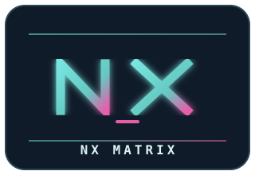
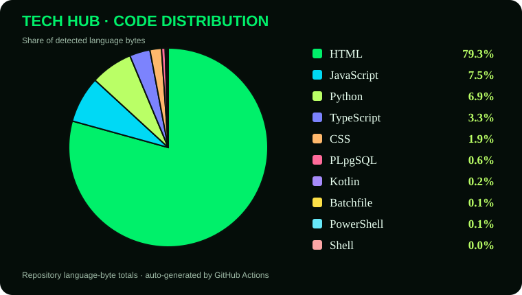

<!--
NX MATRIX · ENGINEERING & AI AUTOMATION
Ideas | Intelligence | Impact
A green, code-first engineering profile focused on software, AI systems, and practical automation.
Palette: Deep Forest #071B14 · Terminal Green #0D281C · Emerald #1F8A5B · Mint #A7F3D0 · Code Green #4ADE80
-->

# NX MATRIX

### SOFTWARE ENGINEERING · AI SYSTEMS · AUTOMATION

<code>IDEAS → CODE → INTELLIGENCE → AUTOMATION → IMPACT</code>

---

## ENGINEERING PROFILE

I'm **Nitin Kumar Singh**, a Data Science graduate from the **University of Mumbai** (2026), currently gaining industry experience as an intern with the **AI COE team at the National Stock Exchange of India (NSE)**.

**NX Matrix** is my engineering workspace for designing, building, and testing practical software systems.

- **Software engineering** — web applications, APIs, integrations, and maintainable code.
- **AI engineering** — local LLMs, model integrations, AI-assisted developer tools, and applied AI workflows.
- **Data intelligence** — Python, data analysis, machine learning experiments, and visualisation.
- **AI automation** — browser automation, extensions, MCP integrations, reusable workflows, and supervised execution.

The focus is on moving beyond prototypes: understand the problem, build useful systems, verify their behaviour, and document their limitations.

> **Ideas | Intelligence | Impact** — Turn ideas into reliable software and practical automation.

This GitHub profile is the technical home of NX Matrix: source code, engineering activity, repository language analytics, and project updates. Visit the **[Main Portfolio](https://portfolio-psi-ochre-jabym9b7ir.vercel.app)** for my personal website and the separate **[Projects Lab](https://portfolio-psi-ochre-jabym9b7ir.vercel.app/projects-showcase)** for project demos and feature showcases.

## CURRENT ENGINEERING FOCUS

- **Application development:** frontend interfaces, backend services, APIs, databases, and debugging.
- **AI systems:** local model workflows, LLM integrations, AI-powered utilities, and model-assisted development.
- **Automation infrastructure:** browser control, extensions, MCP services, reusable skills, and execution verification.
- **Data science:** Python-based analysis, machine learning, data processing, and visualisation.

## FEATURED PROJECT

The newest eligible public repository, selected automatically from GitHub metadata.

<!-- AUTO:LATEST_PROJECT:START -->
<table width="100%" border="0" cellpadding="0" cellspacing="0" bgcolor="#101B29">
<tr><td bgcolor="#78E4DF" height="4"></td></tr>
<tr><td align="center" style="padding:26px 18px;">

✦ &nbsp; NX MATRIX / FEATURED BUILD &nbsp; · &nbsp; LATEST COMMIT · PUBLIC REPOSITORY

<h2 align="center"><a href="https://github.com/ns-matrix/karma-fire-protection">🚀 karma-fire-protection</a></h2>

Website

<b>LANGUAGE</b> &nbsp; HTML &nbsp;&nbsp; <b>CREATED</b> &nbsp; 2026-11-20 &nbsp;&nbsp; <b>LAST COMMIT</b> &nbsp; 2026-11-21

<b>LATEST COMMIT</b> <a href="https://github.com/ns-matrix/karma-fire-protection/commit/4d486a312b60f4eae05dcc7f682db3565362227d">Create CNAME</a>

<a href="https://github.com/ns-matrix/karma-fire-protection">VIEW PROJECT &nbsp; ↗</a>

</td></tr>
<tr><td bgcolor="#E65EAA" height="3"></td></tr>
</table>
<!-- AUTO:LATEST_PROJECT:END -->

## TECH HUB · REPOSITORY LANGUAGE ANALYTICS

This visual is generated from GitHub's language-byte statistics across public, non-fork, non-archived repositories. Percentages represent detected code volume — **not skill level or proficiency**.

<!-- AUTO:TECH_HUB:START -->

\n\n

<!-- AUTO:TECH_HUB:END -->

## ENGINEERING TOOLKIT

Technologies used or explored across projects. The analytics above are generated from repository data; these badges are a concise overview of my current engineering toolkit.

**Also exploring:** Pandas · NumPy · Streamlit · REST APIs · Power BI · local LLMs · MCP

## GITHUB ACTIVITY

Repository language activity based on GitHub commit data. This card is provided by GitHub Profile Summary Cards and may occasionally be unavailable.

## ENGINEERING PRINCIPLES

- **Understand first:** inspect requirements, constraints, and the existing system before changing code.
- **Build deliberately:** make focused changes and keep implementations maintainable.
- **Automate responsibly:** use clear permissions, observable actions, and supervised execution where needed.
- **Verify the result:** test important paths and document failures or limitations honestly.
- **Keep learning:** use repository history, issues, reviews, and experiments to improve the system.

## EXPLORE NX MATRIX

| Looking for… | Destination |
|---|---|
| Personal website and introduction | [Main Portfolio](https://portfolio-psi-ochre-jabym9b7ir.vercel.app) |
| Project demos and feature showcases | [Projects Lab](https://portfolio-psi-ochre-jabym9b7ir.vercel.app/projects-showcase) |
| Source code and engineering activity | [GitHub repositories](https://github.com/ns-matrix?tab=repositories) |
| Professional background and updates | [LinkedIn](https://www.linkedin.com/in/nitin-kumar-singh-339210262/) |

<code>NX MATRIX · IDEAS | INTELLIGENCE | IMPACT</code>

Green code. Applied intelligence. Practical automation.

