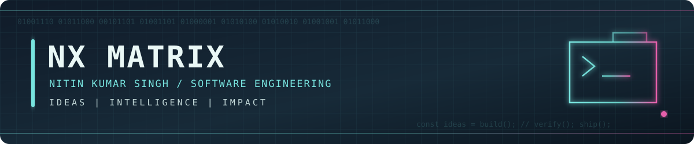

<!--
  NX MATRIX | GitHub Profile
  Theme: Pixel-art cyberpunk engineering workstation
  Palette: #101B29 #142633 #203744 | #66C8C2 #78E4DF #E65EAA
  Motto: Ideas | Intelligence | Impact
-->

 

  

---

## 

### Hey, I'm Nitin Kumar Singh.

I’m a software developer and Data Science graduate from the **University of Mumbai (2026)**, currently an intern with the **AI COE team at the National Stock Exchange of India (NSE)**.

I use this GitHub profile as my engineering logbook: a place to build applications, experiment with AI, explore data, and document practical implementations.

**NX MATRIX** is the personal project identity behind that work.

> **IDEAS** become experiments. **INTELLIGENCE** makes them useful. **IMPACT** is the outcome.

---

## 

<table width="100%">
  <tr>
    <td width="50%" valign="top">
      <h3>▣ Software Engineering</h3>
      Web applications, frontend interfaces, backend services, APIs, and integrations.
    </td>
    <td width="50%" valign="top">
      <h3>◈ Applied AI</h3>
      Local LLMs, model integrations, AI-assisted developer tools, and practical AI workflows.
    </td>
  </tr>
  <tr>
    <td width="50%" valign="top">
      <h3>▦ Data Intelligence</h3>
      Python, data analysis, machine learning experiments, and data visualisation.
    </td>
    <td width="50%" valign="top">
      <h3>⌘ Browser Automation</h3>
      Browser workflows, extensions, MCP integrations, and supervised task execution.
    </td>
  </tr>
</table>

## 

- Building useful software from requirements through implementation and testing.
- Connecting local AI models with developer tools and automation workflows.
- Exploring reliable browser automation and Model Context Protocol (MCP) integrations.
- Improving data-driven applications with real integrations and transparent system behaviour.

---

## 

The Android companion app for **NX Matrix WhatsApp Message Manager**. Explore the repository for its implementation, source code, and current development status.

**More work:** [Browse all public repositories →](https://github.com/ns-matrix?tab=repositories) · [Open the Projects Lab →](https://portfolio-psi-ochre-jabym9b7ir.vercel.app/projects-showcase)

---

## 

  

Tools and technologies shown reflect work across projects and ongoing exploration; they are not a claim of equal proficiency in every tool.

---

## 

 

Stats and activity graphs are generated by third-party services and may be temporarily unavailable. Language charts describe repository code volume, not proficiency.

---

## 

| Principle | How I apply it |
|---|---|
| Understand the system | Read the requirements and inspect existing behaviour before changing code. |
| Build with intent | Prefer focused implementations and maintainable structure. |
| Verify, don't assume | Test important paths and distinguish working features from planned ones. |
| Learn in public | Keep code, experiments, and technical progress discoverable. |

---

## 

**Have an idea, useful project, or engineering problem to discuss?**

  

▣ NX MATRIX · PIXEL ENGINEERING EDITION · IDEAS | INTELLIGENCE | IMPACT

